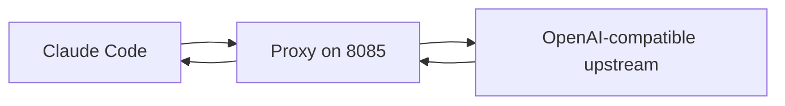

# openai-to-anthropic-proxy

[](https://github.com/HeylonNHP/openai-to-anthropic-proxy/actions/workflows/ci.yml)
[](./LICENSE)
[](https://www.rust-lang.org/tools/install)

Run **Claude Code** on any **OpenAI-compatible** model — a small Rust proxy
that translates Anthropic Messages requests into OpenAI Responses API calls and
back.

Claude Code only speaks Anthropic's API. This proxy speaks yours: point
`ANTHROPIC_BASE_URL` at it and it forwards to OpenAI, NVIDIA NIM, vLLM, or any
other OpenAI-compatible upstream — streaming, tool use, extended thinking and
all.



## Quick start

**Terminal 1 — the proxy:**

```bash
# 1. point it at your upstream
export UPSTREAM_BASE_URL=https://api.openai.com
export UPSTREAM_API_KEY=sk-...

# 2. run it
cargo run --release
```

It listens on `http://localhost:8085`. The proxy opens a full-screen TUI that
owns its terminal, so run Claude Code from a **second terminal** — or pass
`--no-tui` and background the process yourself.

**Terminal 2 — Claude Code:**

```bash
export ANTHROPIC_BASE_URL=http://localhost:8085
export ANTHROPIC_API_KEY=any
claude
```

Instead of the env vars you can copy
[`proxy.json.example`](./proxy.json.example) to `proxy.json` and fill it in —
the file and the env vars use the same names, and **env vars win**.

To make the client side permanent, put the `env` block in your user-level
settings file (`~/.claude/settings.json`, or `%USERPROFILE%\.claude\settings.json`
on Windows):

```json
{
  "env": {
    "ANTHROPIC_BASE_URL": "http://localhost:8085",
    "ANTHROPIC_API_KEY": "any",
    "CLAUDE_CODE_MAX_CONTEXT_TOKENS": "1000000"
  }
}
```

`CLAUDE_CODE_MAX_CONTEXT_TOKENS` tells Claude Code the upstream's *real* context
window. Without it Claude Code assumes Anthropic's 200K default and
auto-compacts too early on 1M-context models.

There are also launch scripts that start **Claude Code** against an already
running proxy, and that pass `--setting-sources=project,local` so a
project-local `settings.json` does not override your `ANTHROPIC_BASE_URL`:
[`start-claude-code.sh`](./scripts/start-claude-code.sh) (macOS/Linux) and
[`start-claude-code.ps1`](./scripts/start-claude-code.ps1) (Windows). They
check the proxy is reachable first and tell you if it is not.

## Configuration

| Variable | Default | Required? | Notes |
|---|---|---|---|
| `UPSTREAM_BASE_URL` | — | yes | e.g. `https://api.openai.com` |
| `UPSTREAM_API_KEY` | — | yes | bearer token for the upstream |
| `LISTEN_ADDR` | `0.0.0.0:8085` | no | socket to bind |
| `UPSTREAM_PATH` | `/v1/responses` | no | appended to the base URL |
| `MAX_REQUEST_BODY_BYTES` | `33554432` (32 MiB) | no | byte cap for `POST /v1/messages` |
| `PROXY_KEY` | — | no | shared secret; see below |
| `LOG_TO_DISK` | `false` | no | write `target/logs/proxy.log` |

That is the short list. The full one — every environment variable, every
`proxy.json` field, and the reasoning-effort and caching settings — is in
[`CONFIGURATION.md`](./CONFIGURATION.md), with the edge cases and per-tool
semantics in [`proxy.json-guide.md`](./proxy.json-guide.md).

Unknown fields in `proxy.json` **fail fast at startup** rather than being
silently ignored, so a typo is a startup error, not a mystery.

### Securing the listener

The proxy binds `0.0.0.0:8085` by default, so set a shared secret if anything
else can reach it:

```json
{ "proxy_key": "any-shared-secret-string" }
```

Every `/v1/messages` request then needs a matching `X-Proxy-Key` header, or the
proxy answers 401:

```json
{
  "env": {
    "ANTHROPIC_BASE_URL": "http://localhost:8085",
    "ANTHROPIC_API_KEY": "any",
    "ANTHROPIC_CUSTOM_HEADERS": "X-Proxy-Key: your-secret-here"
  }
}
```

The launch scripts forward `PROXY_KEY` automatically. The comparison is
constant-time, and `/healthz` stays unauthenticated.

### Gateway model discovery (`/v1/models`)

Claude Code does not query `/v1/models` by default. To populate its `/model`
autocomplete from the proxy instead of typing alias names by hand:

```json
{ "env": { "CLAUDE_CODE_ENABLE_GATEWAY_MODEL_DISCOVERY": "1" } }
```

The proxy forwards to the upstream's `/v1/models` and translates each entry
into Anthropic's model shape (id, display name, created_at, and — when
`model_info` configures them — max_input_tokens, max_tokens, capabilities
and description). With an upstream that has no such endpoint, it returns
your `model_aliases.map` keys plus `default_model`.

## Features

- **Streaming** end to end (SSE).
- **Tool use** round trips: `tool_use` ↔ `tool_calls`, `tool_result` ↔ `tool`.
- **Extended thinking**: reasoning is generated from the upstream's `reasoning`
  output and replayed back upstream on the next turn.
- **Reasoning-effort** mapping (`low`/`medium`/`high`/`xhigh`/`max`).
- **Images** in user messages and in tool results, forwarded upstream.
- **Stop reasons and token usage** remapped into Anthropic's shape.
- **Model aliases** with a `default_model` fallback when the upstream rejects
  a model outright.
- **Prompt caching** on allowlisted models.
- **`POST /v1/messages/count_tokens`** (the upstream's count, or a local
  estimate), **`GET /v1/models`** for gateway model discovery,
  **`GET /v1/models/{id}`** for one model, and **`GET /healthz`**
  for liveness checks.
- An optional shared-secret `proxy_key` for a bind-all listener.

**Not for you if** you need model-generated images, full multimodal assistant
turns, Anthropic's other server-side tools (`code_execution`, …), or TLS
termination. See [out of scope](./REFERENCE.md#out-of-scope).

## Optional: the proxy's own server tools

Three server-side tools, all **off by default**. They share one loop, so a
request can use any mix of them in one turn.

| Tool | What it does | Enable it with |
|---|---|---|
| `web_fetch` | fetches a URL, strips the chrome, hands the readable text to the model | `{ "web_fetch": { "enabled": true } }` |
| `web_search` | DuckDuckGo scraping + page fetching + compaction, as a swap-in for the upstream's built-in search | `{ "web_search": { "enabled": true } }` |
| `advisor` | a second-opinion consultation inside one assistant message | `{ "advisor": { "enabled": true, "model": "beam" } }` |

Three things worth knowing:

- **A round limit.** The shared loop runs at most `server_tools.max_rounds`
  rounds (default 10, like Anthropic's own loop). `0` removes the limit — set
  it if you also set an unlimited `advisor.max_uses`, or the default will end
  the turn first.
- **The client's own options apply.** `max_uses`, `allowed_domains` /
  `blocked_domains`, `user_location` and `max_content_tokens`, as the client
  sets them on its tool, are honoured.
- **A failed tool call never fails the request.** The model is told what
  happened and the turn continues.

The advisor also needs the **client** side enabled — `advisorModel` and
`CLAUDE_CODE_ENABLE_EXPERIMENTAL_ADVISOR_TOOL` in `~/.claude/settings.json`,
because Claude Code otherwise waits for a feature flag it cannot fetch:

```json
{
  "advisorModel": "opus",
  "env": { "CLAUDE_CODE_ENABLE_EXPERIMENTAL_ADVISOR_TOOL": "1" }
}
```

Set `CLAUDE_CODE_DISABLE_ADVISOR_TOOL=1` (or remove `advisorModel`) to turn it
off again. Until `advisor.enabled` is true in `proxy.json`, Claude Code
declares the tool but no consultation runs.

> Claude Code CLI does **not** declare the server-side `web_fetch` tool — it has
> its own client-side `WebFetch` and does the fetching itself. `web_fetch` is
> for Anthropic-API clients that declare the server tool.

Limits, caveats and every knob:
[`proxy.json-guide.md`](./proxy.json-guide.md#advisor-advisor),
[`src/tools/web_search/README.md`](./src/tools/web_search/README.md) and
[`src/tools/server_loop/README.md`](./src/tools/server_loop/README.md).

## Troubleshooting

- **Claude Code still hits Anthropic.** Your user-level `settings.json`
  re-applies `ANTHROPIC_BASE_URL`. Run via the launch scripts (which pass
  `--setting-sources=project,local`), or move the proxy settings into that
  file.
- **`401 Unauthorized`.** `proxy_key` is set but `X-Proxy-Key` is missing or
  wrong. Add it via `ANTHROPIC_CUSTOM_HEADERS`, or run through the launch
  scripts with `PROXY_KEY` exported.
- **Conversations auto-compact too early.** Set
  `CLAUDE_CODE_MAX_CONTEXT_TOKENS` to the upstream model's real window.
- **Nothing happens after `cargo run`.** Confirm
  `UPSTREAM_BASE_URL`/`UPSTREAM_API_KEY` or a valid `proxy.json`; unknown fields
  fail fast at startup.
- **The proxy exits immediately.** It starts a TUI by default; pass `--no-tui`
  for a plain foreground process.

## Documentation

| Document | What is in it |
|---|---|
| [`REFERENCE.md`](./REFERENCE.md) | Architecture, translation overview, out-of-scope list |
| [`CONFIGURATION.md`](./CONFIGURATION.md) | Every `proxy.json` option with its environment variable, plus the Claude Code settings that point at the proxy |
| [`proxy.json.example`](./proxy.json.example) | A filled-in example config |
| [`src/tools/web_search/README.md`](./src/tools/web_search/README.md) | How the proxy-native search works, and its limits |
| [`src/tools/server_loop/README.md`](./src/tools/server_loop/README.md) | The shared server-tool loop |
| [`ADVISOR_FAULTS.md`](./ADVISOR_FAULTS.md) | The advisor fault record (all fixed) and the Pi deployment steps that remain |

## Development

```bash
cargo test                      # unit + e2e tests
cargo clippy --all-targets      # the lint gate; must stay warning-free
cargo fmt --all -- --check      # formatting
```

CI runs all three on every push, plus a build check on macOS and Windows.

## License

[GPL-3.0](./LICENSE). You may use, modify and redistribute the code; any
derivative must also be distributed under GPL-3.0 with its source available.
