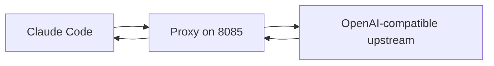

# openai-to-anthropic-proxy

Run **Claude Code** on *any* **OpenAI-compatible** model — streaming, tool-use, extended
thinking, and the experimental advisor tool included. Point Claude Code at a small Rust
proxy listening on port `8085` (all interfaces by default — see [`proxy_key`](#if-the-proxy-is-configured-with-proxy_key)); it translates Anthropic Messages requests into OpenAI
Responses API calls, forwards them to the upstream you choose (OpenAI, NVIDIA NIM,
vLLM, an internal gateway …), and translates the answers back.



**Not for you if** you need model-generated images, full multimodal assistant
turns, Claude's other server-side tools (`code_execution`, …),
or TLS termination — those are out of scope (see [`REFERENCE.md`](./REFERENCE.md)).
`GET /v1/models` is implemented (for gateway model discovery).
Images *sent to* the model — including images inside tool results — are supported.
The server-side `web_fetch`, `web_search` and `advisor` tools *are* implemented
by the proxy itself and can be used together in one turn — see
[Server tools together](#server-tools-together).

## Features

- Streaming SSE end to end.
- Tool-use round trips: `tool_use` ↔ `tool_calls`, `tool_result` ↔ `tool` messages.
- Image input support: `image` blocks in user messages and in `tool_result` are forwarded upstream (see `tool_result_images` in [proxy.json-guide.md](./proxy.json-guide.md#tool-result-images-tool_result_images)).
- Stop-reason and token-usage remapping into Anthropic shape.
- `model_aliases` with a `default_model` safety net if an upstream rejects a model.
- Reasoning-effort mapping (`low`/`medium`/`high`/`xhigh`/`max`) plus extended-thinking replay.
- Unlocking 1M-context upstreams via `CLAUDE_CODE_MAX_CONTEXT_TOKENS`.
- Server-side `web_fetch`: the proxy fetches the URL, extracts the readable text, and hands it back to the model (opt-in).
- Optional proxy-native `web_search`: DuckDuckGo scraping + page fetching + compaction, as a swap-in for the upstream's built-in search (opt-in).
- Server tools work together: `web_search`, `web_fetch` and the advisor share one loop, honour the options the client sets on them (`max_uses`, domain lists, …), and stream each round to the client as it finishes.
- `GET /healthz` for liveness checks.
- `GET /v1/models` for Claude Code's gateway model discovery (opt-in via `CLAUDE_CODE_ENABLE_GATEWAY_MODEL_DISCOVERY=1`).
- Optional shared-secret `proxy_key` auth for a bind-all listener.

## Quick start

1. You need a Rust toolchain (edition 2024) and a Claude Code install. Set
   `UPSTREAM_BASE_URL` and `UPSTREAM_API_KEY`, or copy `proxy.json.example` to
   `proxy.json` and fill them in.
   - For a fuller walkthrough of `proxy.json`, see the [proxy.json guide](./proxy.json-guide.md).
2. Start the proxy:

   ```bash
   cargo run --release
   ```

   It listens on `http://localhost:8085` by default ("proxy listening on …").
3. Launch Claude Code against it:

   - macOS/Linux: `./scripts/start-claude-code.sh`
   - Windows: `./scripts/start-claude-code.ps1`

   All relative paths assume you run from the repo root.

## Configure Claude Code once

To use the proxy on every `claude` invocation, update your user-level settings file
instead of the launch scripts. On Windows that is typically
`%USERPROFILE%\.claude\settings.json` (e.g. `C:\Users\hwhite\.claude\settings.json`).

Merge these into any existing `env` block:

```json
{
  "env": {
    "ANTHROPIC_BASE_URL": "http://localhost:8085",
    "ANTHROPIC_API_KEY": "any",
    "CLAUDE_CODE_MAX_CONTEXT_TOKENS": "1000000"
  }
}
```

`CLAUDE_CODE_MAX_CONTEXT_TOKENS` tells Claude Code the real context window of the
upstream model. Without it Claude Code assumes the Anthropic 200K default and
auto-compacts too early for 1M-context models (e.g. GPT-5.4-mini, GPT-5.6-luna).

Then run `claude` directly. Config details, script behaviour, and protocol notes live
in [`REFERENCE.md`](./REFERENCE.md).

### Configuration at a glance

| Variable | Default | Required? | Notes |
|---|---|---|---|
| `UPSTREAM_BASE_URL` | — | yes | e.g. `https://api.openai.com` |
| `UPSTREAM_API_KEY` | — | yes | bearer token for the upstream |
| `LISTEN_ADDR` | `0.0.0.0:8085` | no | socket to bind |
| `UPSTREAM_PATH` | `/v1/responses` | no | appended to base URL |
| `MAX_REQUEST_BODY_BYTES` | `33554432` (32 MiB) | no | positive whole-number byte cap for `/v1/messages`; invalid numeric values warn and use the default |
| `PROXY_KEY` | — | no | shared secret; see below |
| `LOG_TO_DISK` | `false` | no | write `target/logs/proxy.log` |

The proxy also reads `proxy.json` (same field names, snake_case), including
`max_request_body_bytes` (positive whole number of bytes; defaults to 33,554,432
bytes / 32 MiB). `MAX_REQUEST_BODY_BYTES` overrides the file. Invalid numeric
values (zero, negative, fractional, or out of range) warn and fall back to the
default; non-numeric environment text is ignored. Unknown fields fail fast at startup.

### If the proxy is configured with `proxy_key`

The listener binds `0.0.0.0:8085` by default, so set a shared secret if anything
else can reach it:

```json
{ "proxy_key": "any-shared-secret-string" }
```

Then every `/v1/messages` request needs a matching `X-Proxy-Key` header, or the
proxy returns 401. Wire it into Claude Code via `ANTHROPIC_CUSTOM_HEADERS`:

```json
{
  "env": {
    "ANTHROPIC_BASE_URL": "http://localhost:8085",
    "ANTHROPIC_API_KEY": "any",
    "CLAUDE_CODE_MAX_CONTEXT_TOKENS": "1000000",
    "ANTHROPIC_CUSTOM_HEADERS": "X-Proxy-Key: your-secret-here"
  }
}
```

Launch scripts forward `PROXY_KEY` automatically. Details, constant-time compare,
and `/healthz` exemption: [`REFERENCE.md`](./REFERENCE.md#client-auth-proxy_key--proxy_key).

### Enabling the advisor tool

The proxy implements Anthropic's experimental advisor tool server-side, off by
default. Turn it on in `proxy.json`:

```json
{ "advisor": { "enabled": true, "model": "beam", "max_uses": 2 } }
```

Claude Code also needs a persistent advisor model. Merge into `~/.claude/settings.json`
(keep your existing `env` block — it holds `ANTHROPIC_BASE_URL` and your keys):

```json
{
  "advisorModel": "opus",
  "env": {
    "CLAUDE_CODE_ENABLE_EXPERIMENTAL_ADVISOR_TOOL": "1"
  }
}
```

`advisorModel` sets the advisor (`opus`/`sonnet`/full model id); the env var is
required behind a custom `ANTHROPIC_BASE_URL` because Claude Code otherwise waits
for a feature flag it cannot fetch. Set `CLAUDE_CODE_DISABLE_ADVISOR_TOOL=1` (or
remove `advisorModel`) to turn it off. A failed consultation degrades to
`advisor_tool_result_error` (`unavailable`) instead of failing the request; until
`advisor.enabled` is true in `proxy.json`, Claude Code declares the tool but no
consultation runs.

Deep protocol notes, reverse-engineering, and implementation history:
[`ADVISOR_TOOL_RESEARCH.md`](./ADVISOR_TOOL_RESEARCH.md).

### Enabling the proxy's own web search

By default the client's `web_search` tool is handled by the upstream's built-in
search. To use the proxy's own search instead (DuckDuckGo scraping, every result
page fetched and, if long, compacted), enable it in `proxy.json`:

```json
{
  "web_search": {
    "enabled": true,
    "compaction_model": "a-cheap-upstream-model",
    "compaction_threshold_chars": 5000,
    "max_queries": 3,
    "max_results_per_query": 5
  }
}
```

Everything except `enabled` is optional and bounded — there is no unlimited
setting. Without a `compaction_model`, long pages are truncated rather than
summarised. Disable it again and the upstream's search is used as before. See
[`src/tools/web_search/README.md`](./src/tools/web_search/README.md) for how it
works, its limits, and how to remove it.

### Server tools together

`web_search` (if enabled), `web_fetch` (if enabled) and the advisor (if enabled)
all run on one shared loop, so a request can declare any mix of them and the
model can use all of them in one turn. Three things worth knowing:

- **A round limit.** A request runs at most `server_tools.max_rounds` rounds
  (default 10, like Anthropic's own loop). At the limit the model is told and
  gets one last run to answer. `0` removes the limit — set it if you also set an
  unlimited `advisor.max_uses`, or the 10-round default will end the turn first.
- **`pause_turn`.** `server_tools.pause_turn: true` returns the work so far with
  `stop_reason: "pause_turn"` at the limit instead, as Anthropic's API does, for
  clients that resume. **Claude Code does not resume it**, so it is off by default.
- **The client's own options apply.** `max_uses`, `allowed_domains` /
  `blocked_domains`, `user_location` and `max_content_tokens`, as the client sets
  them on its tool, are honoured by the proxy's search and fetch.

```json
{ "server_tools": { "max_rounds": 10, "pause_turn": false } }
```

Full details: [`src/tools/server_loop/README.md`](./src/tools/server_loop/README.md).

### Enabling the web_fetch tool

Anthropic's `web_fetch` is a *server* tool: the client declares it and the
server does the HTTP GET. The proxy implements it, off by default. Turn it on in
`proxy.json`:

```json
{ "web_fetch": { "enabled": true } }
```

When a client declares the server-side tool and the model asks for a URL, the
proxy fetches the page, strips the navigation and other chrome, and hands the
readable text back to the model so it can answer with the page in context.

- `timeout_secs` (default 20) bounds the whole fetch — connect, read, extract.
- `max_bytes` and `max_content_bytes` are **unlimited** by default; set either
  to cap the download or the extracted text.
- The operator sets no domain allow-list and no URL-length limit — the proxy
  fetches any `http`/`https` URL the model asks for, unless the *client* put
  `allowed_domains` / `blocked_domains` on its tool (then those apply). It
  always refuses private and reserved addresses (loopback, LAN, cloud
  metadata …) and re-checks every redirect.
- A failed fetch never fails the request: the model is told the fetch failed and
  the turn continues.

Note: **Claude Code CLI does not declare this tool** — it has its own client-side
`WebFetch` tool and does the fetching itself. This is for Anthropic-API clients
that declare the server tool (the Claude Agent SDK, direct Messages API calls,
gateways that add it for the client). Details: [`REFERENCE.md`](./REFERENCE.md#server-side-web_fetch).

#### Removing the limits

The advisor's three limits in `proxy.json` are removed by **zeroing** them:

```json
"advisor": {
  "enabled": true,
  "model": "beam",
  "max_uses": 0,
  "max_tokens": 0,
  "timeout_secs": 0
}
```

A **`0` means "no limit"** for `max_uses`, `max_tokens` and `timeout_secs`
(in `proxy.json` and in the `ADVISOR_*` env vars alike). **Omitting a key is
not the same thing** — an absent key keeps the shipped default (`max_uses` 2,
`max_tokens` 2048, `timeout_secs` 45), so a config that only sets
`"enabled": true` gets the safe, bounded behaviour.

"No limit" means something different per field, so read the caveats in
[`proxy.json-guide.md`](./proxy.json-guide.md#advisor-advisor) before setting
it:

- **`max_uses: 0`** removes the consultation loop's only backstop — the
  executor may call `advisor` as often as it likes, and each iteration costs
  **two** upstream calls (the executor re-run *and* the advisor). The proxy
  imposes no ceiling of its own, but warns once at startup and once per turn
  that passes 10 consultations.
- **`max_tokens: 0`** means the *proxy* stops capping the advisor's answer:
  it omits `max_output_tokens` so the **upstream's** own default applies —
  which may be *smaller* than 2048. If your upstream's default is too small,
  set an explicit number instead.
- **`timeout_secs: 0`** applies no per-request timeout override, so the
  global `request_timeout_secs` still bounds the call. A *finite*
  `timeout_secs` is always clamped to that global bound.

The advisor's prompt (the executor's whole conversation) is also held to a
fixed built-in budget of 1,200,000 characters, roughly 400,000 tokens, so a
long session cannot overflow the advisor model's context window. Tool results,
then long strings, then the oldest items are trimmed; the user's task and the
latest items are always kept. It is not configurable; see
[`proxy.json-guide.md`](./proxy.json-guide.md#the-advisor-prompt-is-trimmed-to-a-fixed-size).

An invalid limit (negative, fractional, or too large) is never a startup
failure: the proxy starts anyway, falls back to that limit's shipped default,
and prints a warning.

## Troubleshooting

- **Claude Code still hits Anthropic.** Your user-level `settings.json` re-applies
  `ANTHROPIC_BASE_URL`. Run via the launch scripts (which pass
  `--setting-sources=project,local`), or move the proxy settings into that file.
- **`401 Unauthorized`.** `proxy_key` is set but `X-Proxy-Key` is missing or wrong.
  Add it via `ANTHROPIC_CUSTOM_HEADERS` (see above) or run through the launch
  scripts with `PROXY_KEY` exported.
- **Conversations auto-compact too early.** Set `CLAUDE_CODE_MAX_CONTEXT_TOKENS` to
  the upstream model's real window.
- **Nothing happens after `cargo run`.** Confirm `UPSTREAM_BASE_URL`/`UPSTREAM_API_KEY`
  or a valid `proxy.json`; unknown fields fail fast at startup.

## License, contributing, and more

- **License:** none granted by default — see [`REFERENCE.md`](./REFERENCE.md#license)
  before redistributing.
- **Development:** `cargo test`; `cargo clippy --all-targets`; `cargo fmt --all -- --check`
  (details in [`REFERENCE.md`](./REFERENCE.md#development)).
- **Architecture, translation overview, out-of-scope notes:** [`REFERENCE.md`](./REFERENCE.md).

---

*Built as a personal/professional tool. Bug reports and ideas welcome as issues.*

### Enabling gateway model discovery (`/v1/models`)

Claude Code does not query `/v1/models` by default. To populate the `/model`
autocomplete from the proxy instead of typing alias names by hand, set, in your
shell __before__ launching `claude`:

    export CLAUDE_CODE_ENABLE_GATEWAY_MODEL_DISCOVERY=1

Or in `~/.claude/settings.json` so subagents, MCP and background agents inherit
it (the same way `env` is already documented there):

    {
      "env": {
        "CLAUDE_CODE_ENABLE_GATEWAY_MODEL_DISCOVERY": "1"
      }
    }

The proxy answers `GET /v1/models` by forwarding to the upstream OpenAI-style
`/v1/models`, translating each entry (id, display name, creation time) to the
Anthropic shape. With an upstream lacking that endpoint, it returns the
configured `model_aliases.map` keys plus `default_model`. Claude Code applies its
own `availableModels` allow-list; no proxy config change is required.
