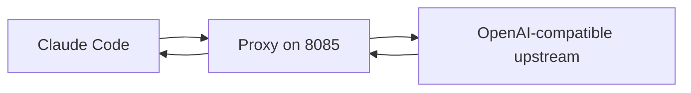

# openai-to-anthropic-proxy

Run **Claude Code** on *any* **OpenAI-compatible** model — streaming, tool-use, extended
thinking, and the experimental advisor tool included. Point Claude Code at a small Rust
proxy on `localhost:8085`; it translates Anthropic Messages requests into OpenAI
Responses API calls, forwards them to the upstream you choose (OpenAI, NVIDIA NIM,
vLLM, an internal gateway …), and translates the answers back.



**Not for you if** you need vision/image inputs, Claude's server-side tools
(`web_search`, `web_fetch`, `code_execution`), `/v1/models`, or TLS termination —
those are out of scope (see [`REFERENCE.md`](./REFERENCE.md)).

## Features

- Streaming SSE end to end.
- Tool-use round trips: `tool_use` ↔ `tool_calls`, `tool_result` ↔ `tool` messages.
- Stop-reason and token-usage remapping into Anthropic shape.
- `model_aliases` with a `default_model` safety net if an upstream rejects a model.
- Reasoning-effort mapping (`low`/`medium`/`high`/`xhigh`/`max`) plus extended-thinking replay.
- Unlocking 1M-context upstreams via `CLAUDE_CODE_MAX_CONTEXT_TOKENS`.
- `GET /healthz` for liveness checks.
- Optional shared-secret `proxy_key` auth for a bind-all listener.

## Quick start

1. You need a Rust toolchain (edition 2024) and a Claude Code install. Set
   `UPSTREAM_BASE_URL` and `UPSTREAM_API_KEY`, or copy `proxy.json.example` to
   `proxy.json` and fill them in.
   - For a fuller walkthrough of `proxy.json`, see the [proxy.json guide](./proxy.json-guide.md).
2. Start the proxy:

   ```bash
   cargo run --release
   ```

   It listens on `http://localhost:8085` by default ("proxy listening on …").
3. Launch Claude Code against it:

   - macOS/Linux: `./scripts/start-claude-code.sh`
   - Windows: `./scripts/start-claude-code.ps1`

   All relative paths assume you run from the repo root.

## Configure Claude Code once

To use the proxy on every `claude` invocation, update your user-level settings file
instead of the launch scripts. On Windows that is typically
`%USERPROFILE%\.claude\settings.json` (e.g. `C:\Users\hwhite\.claude\settings.json`).

Merge these into any existing `env` block:

```json
{
  "env": {
    "ANTHROPIC_BASE_URL": "http://localhost:8085",
    "ANTHROPIC_API_KEY": "any",
    "CLAUDE_CODE_MAX_CONTEXT_TOKENS": "1000000"
  }
}
```

`CLAUDE_CODE_MAX_CONTEXT_TOKENS` tells Claude Code the real context window of the
upstream model. Without it Claude Code assumes the Anthropic 200K default and
auto-compacts too early for 1M-context models (e.g. GPT-5.4-mini, GPT-5.6-luna).

Then run `claude` directly. Config details, script behaviour, and protocol notes live
in [`REFERENCE.md`](./REFERENCE.md).

### Configuration at a glance

| Variable | Default | Required? | Notes |
|---|---|---|---|
| `UPSTREAM_BASE_URL` | — | yes | e.g. `https://api.openai.com` |
| `UPSTREAM_API_KEY` | — | yes | bearer token for the upstream |
| `LISTEN_ADDR` | `0.0.0.0:8085` | no | socket to bind |
| `UPSTREAM_PATH` | `/v1/responses` | no | appended to base URL |
| `PROXY_KEY` | — | no | shared secret; see below |
| `LOG_TO_DISK` | `false` | no | write `target/logs/proxy.log` |

The proxy also reads `proxy.json` (same field names, snake_case). Unknown fields
fail fast at startup.

### If the proxy is configured with `proxy_key`

The listener binds `0.0.0.0:8085` by default, so set a shared secret if anything
else can reach it:

```json
{ "proxy_key": "any-shared-secret-string" }
```

Then every `/v1/messages` request needs a matching `X-Proxy-Key` header, or the
proxy returns 401. Wire it into Claude Code via `ANTHROPIC_CUSTOM_HEADERS`:

```json
{
  "env": {
    "ANTHROPIC_BASE_URL": "http://localhost:8085",
    "ANTHROPIC_API_KEY": "any",
    "CLAUDE_CODE_MAX_CONTEXT_TOKENS": "1000000",
    "ANTHROPIC_CUSTOM_HEADERS": "X-Proxy-Key: your-secret-here"
  }
}
```

Launch scripts forward `PROXY_KEY` automatically. Details, constant-time compare,
and `/healthz` exemption: [`REFERENCE.md`](./REFERENCE.md#client-auth-proxy_key--proxy_key).

### Enabling the advisor tool

The proxy implements Anthropic's experimental advisor tool server-side, off by
default. Turn it on in `proxy.json`:

```json
{ "advisor": { "enabled": true, "model": "beam", "max_uses": 2 } }
```

Claude Code also needs a persistent advisor model. Merge into `~/.claude/settings.json`
(keep your existing `env` block — it holds `ANTHROPIC_BASE_URL` and your keys):

```json
{
  "advisorModel": "opus",
  "env": {
    "CLAUDE_CODE_ENABLE_EXPERIMENTAL_ADVISOR_TOOL": "1"
  }
}
```

`advisorModel` sets the advisor (`opus`/`sonnet`/full model id); the env var is
required behind a custom `ANTHROPIC_BASE_URL` because Claude Code otherwise waits
for a feature flag it cannot fetch. Set `CLAUDE_CODE_DISABLE_ADVISOR_TOOL=1` (or
remove `advisorModel`) to turn it off. A failed consultation degrades to
`advisor_tool_result_error` (`unavailable`) instead of failing the request; until
`advisor.enabled` is true in `proxy.json`, Claude Code declares the tool but no
consultation runs.

Deep protocol notes, reverse-engineering, and implementation history:
[`ADVISOR_TOOL_RESEARCH.md`](./ADVISOR_TOOL_RESEARCH.md).

## Troubleshooting

- **Claude Code still hits Anthropic.** Your user-level `settings.json` re-applies
  `ANTHROPIC_BASE_URL`. Run via the launch scripts (which pass
  `--setting-sources=project,local`), or move the proxy settings into that file.
- **`401 Unauthorized`.** `proxy_key` is set but `X-Proxy-Key` is missing or wrong.
  Add it via `ANTHROPIC_CUSTOM_HEADERS` (see above) or run through the launch
  scripts with `PROXY_KEY` exported.
- **Conversations auto-compact too early.** Set `CLAUDE_CODE_MAX_CONTEXT_TOKENS` to
  the upstream model's real window.
- **Nothing happens after `cargo run`.** Confirm `UPSTREAM_BASE_URL`/`UPSTREAM_API_KEY`
  or a valid `proxy.json`; unknown fields fail fast at startup.

## License, contributing, and more

- **License:** none granted by default — see [`REFERENCE.md`](./REFERENCE.md#license)
  before redistributing.
- **Development:** `cargo test`; `cargo clippy --all-targets --all-features -- -D warnings`;
  `cargo fmt --all -- --check` (details in [`REFERENCE.md`](./REFERENCE.md)).
- **Architecture, translation overview, out-of-scope notes:** [`REFERENCE.md`](./REFERENCE.md).

---

*Built as a personal/professional tool. Bug reports and ideas welcome as issues.*